# 🔐 Password Cracking with JTR & Networkwalks Tools

**Recovering Passwords from Protected PDF Files Using John the Ripper and Browser-Based Cracking Tools**

   

**Week 03 Project | Cybersecurity at Networkwalks**

> 📁 **Note:** All screenshots below are referenced by their exact file name and must
> sit in the **same folder as this README** (repo root) for the images to render on
> GitHub.

---

## 📌 Project Overview

In this project, I practiced recovering passwords from three different locked PDF
files using two separate password-cracking workflows:

1. **Module 1 — John the Ripper (JTR)** via the **Johnny** GUI, run locally.
2. **Module 2 — Networkwalks' own online tools** — the **Hash Calculator** and
   **Password Cracker** — run entirely in the browser.

Both workflows follow the same underlying idea: extract the PDF's password hash
(`$pdf$...`), then run a dictionary attack against that hash until a match is found.

> ⚠️ **Ethical Use:** All PDFs cracked in this lab were provided specifically for
> this exercise. I will only use these techniques on files and systems I own or have
> explicit permission to test.

---

## 🎯 Objectives

My objectives for this project were to:

- [x] Verify that John the Ripper is installed and available.
- [x] Extract a crackable hash (`$pdf$...`) from password-protected PDF files.
- [x] Load each hash into Johnny (JTR GUI) and recover its password.
- [x] Repeat the hash-extraction and cracking process using Networkwalks' Hash
      Calculator and Password Cracker.
- [x] Verify each recovered password by successfully opening its PDF and capturing
      the flag.
- [x] Document the complete workflow with screenshots for every PDF tested.

---

## 🧩 Lab Configuration

| 🧩 Component | ⚙️ Details |
|---|---|
| 🖥️ Platform | Windows |
| 🐉 Alternate Platform | Kali Linux (JTR pre-installed) |
| 🛠️ Tool 1 | John the Ripper (`john`) |
| 🖱️ Tool 1 GUI | Johnny |
| 🌐 Tool 2 | Networkwalks Hash Calculator |
| 🌐 Tool 3 | Networkwalks Password Cracker |
| 📄 Target Files | My-Locked-PDF1.pdf, My-Locked-PDF2.pdf, My-Locked-PDF3.pdf |
| 🔑 Hash Format | `$pdf$...` (pdf2john / hashcat compatible) |

---

## 🛠️ Module 1 — Password Cracking with John the Ripper (Johnny GUI)

**Goal:** Extract the hash from each locked PDF and recover its password locally
using JTR's Johnny GUI.

**Workflow followed for every PDF:**
1. Extracted the PDF's crackable hash (`$pdf$4*4*128*...`) using a `pdf2john`-based
   hash extractor.
2. Saved the hash into a `.txt` file and loaded it into Johnny via **Open password
   file**. Johnny correctly detected the format as `PDF`.
3. Clicked **Start new attack** and let Johnny run its wordlist against the hash.
4. Johnny displayed the recovered password directly in the **Password** column, with
   the status bar confirming `100% (1/1: 1 cracked, 0 left) [format=PDF]`.
5. Entered the recovered password into Adobe Acrobat Reader to unlock the PDF and
   confirm the flag.

### 🔑 PDF 1 — My-Locked-PDF1.pdf

Johnny recovered the password **`good-luck`**:

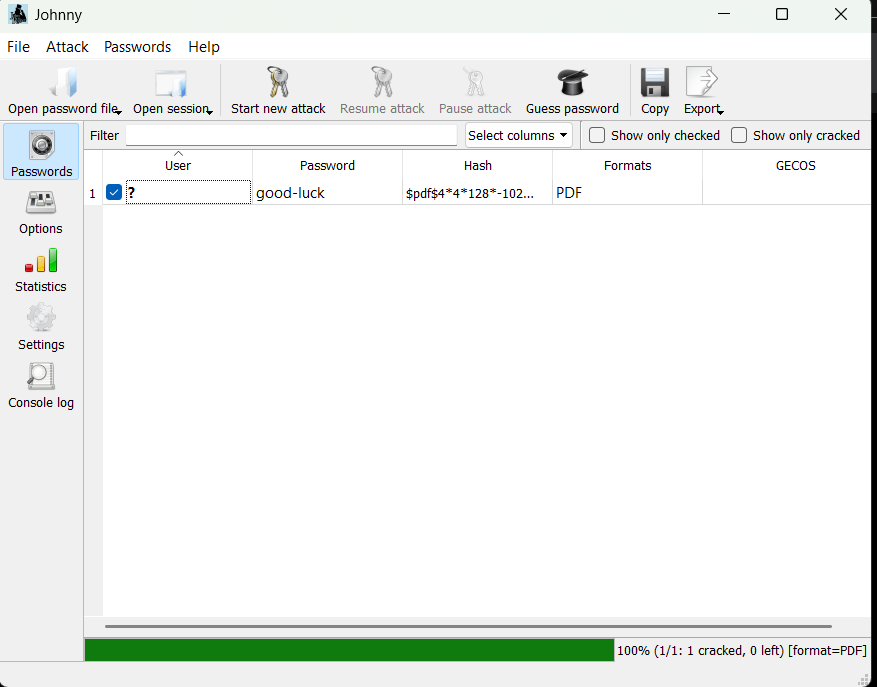

Opening the PDF with this password revealed the flag:


```
nw{cybersecurity_flag_captured_2608}
```

### 🔑 PDF 2 — My-Locked-PDF2.pdf

Johnny recovered the password **`password1`**:

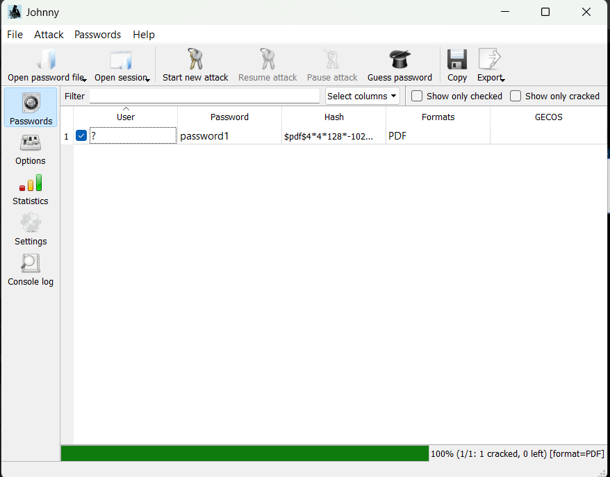

Opening the PDF with this password revealed the flag:

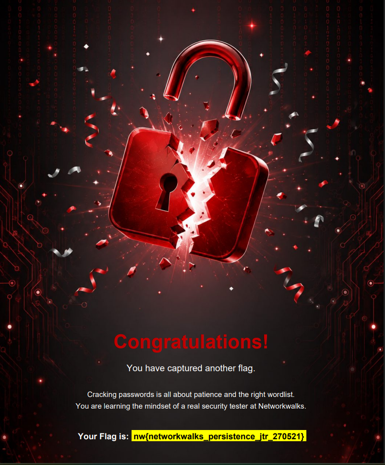

```
nw{networkwalks_persistence_jtr_270521}
```

### 🔑 PDF 3 — My-Locked-PDF3.pdf

Johnny recovered the password **`1qaz2wsx`**:

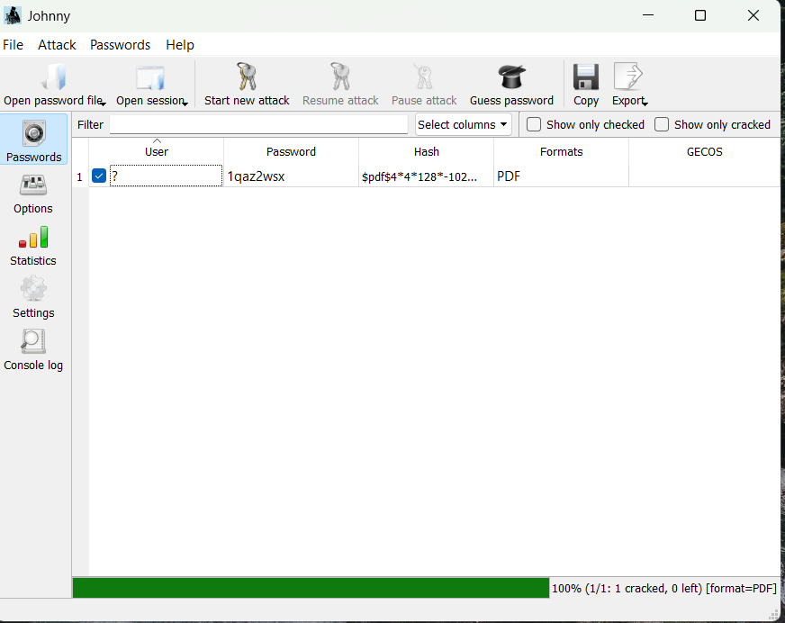

Opening the PDF with this password revealed the flag:

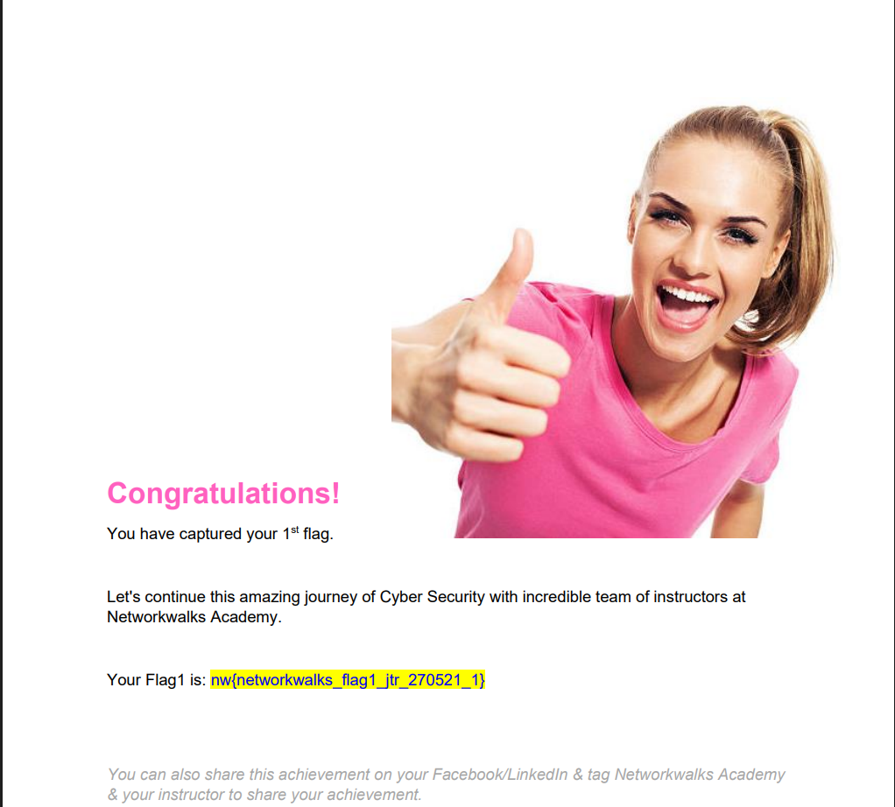

```
nw{networkwalks_flag1_jtr_270521_1}
```

---

## 🌐 Module 2 — Password Cracking with Networkwalks Tools

**Goal:** Repeat the same recovery process on the same three PDFs using
Networkwalks' free, browser-based Hash Calculator and Password Cracker — no local
installation required.

**Workflow followed for every PDF:**
1. Opened the Networkwalks **Hash Calculator**, uploaded the locked PDF, and copied
   the generated `$pdf$...` hash (processed locally in the browser — the file is
   never uploaded to a server).
2. Pasted the hash into the Networkwalks **Password Cracker** and clicked **Start
   Cracking**. The tool ran a dictionary attack, logging each attempted word in real
   time.
3. Used the recovered password to unlock the PDF in Adobe Acrobat Reader and confirm
   the flag.

### 🔑 PDF 1 — My-Locked-PDF1.pdf

**Hash extracted:**

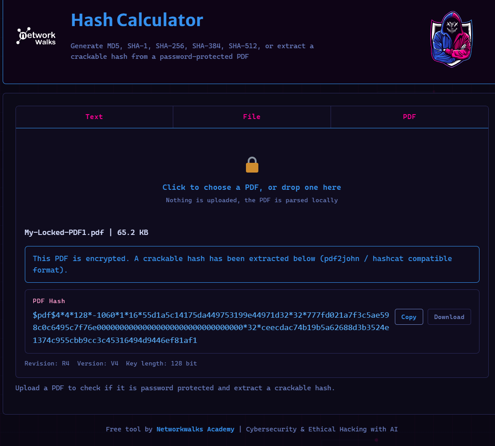

**Password Cracker result — `password1`:**

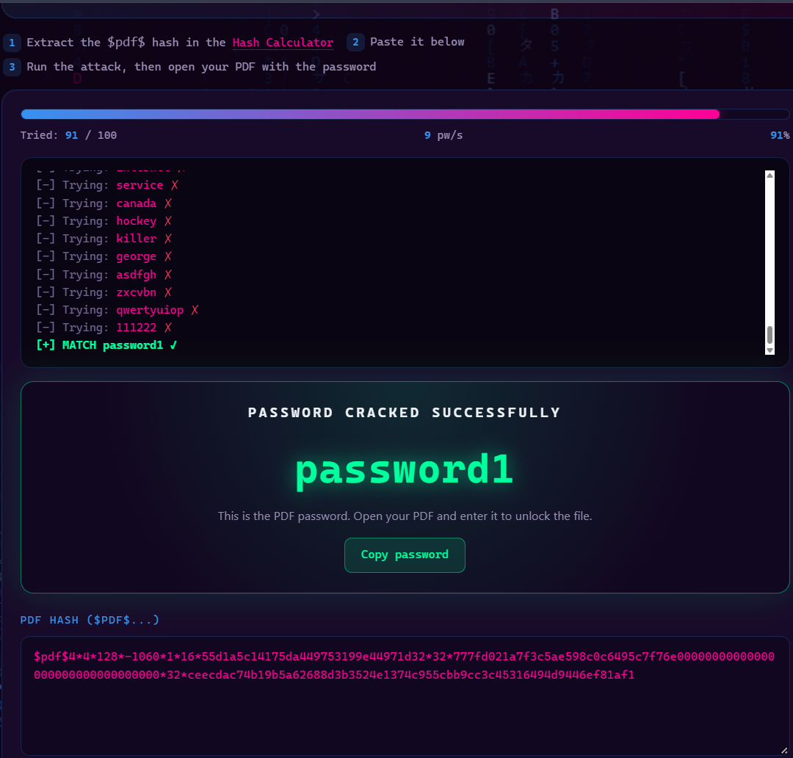

**Flag revealed after opening the PDF:**

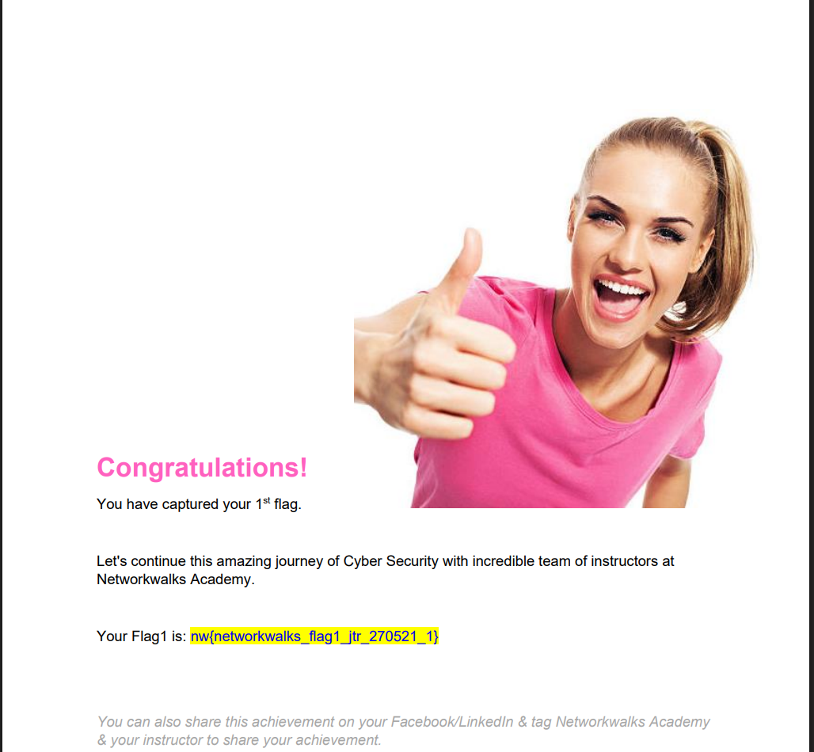

```
nw{networkwalks_flag1_jtr_270521_1}
```

### 🔑 PDF 2 — My-Locked-PDF2.pdf

**Hash extracted:**

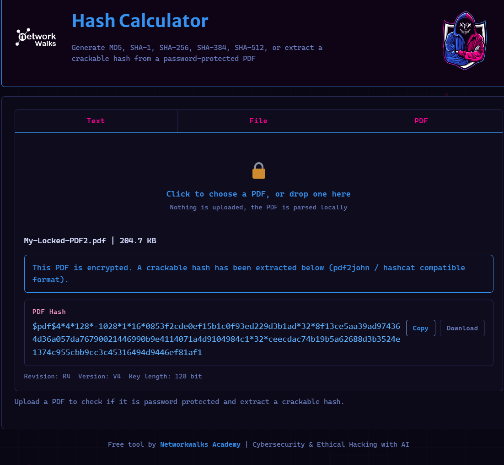

**Password Cracker result — `1qaz2wsx`:**

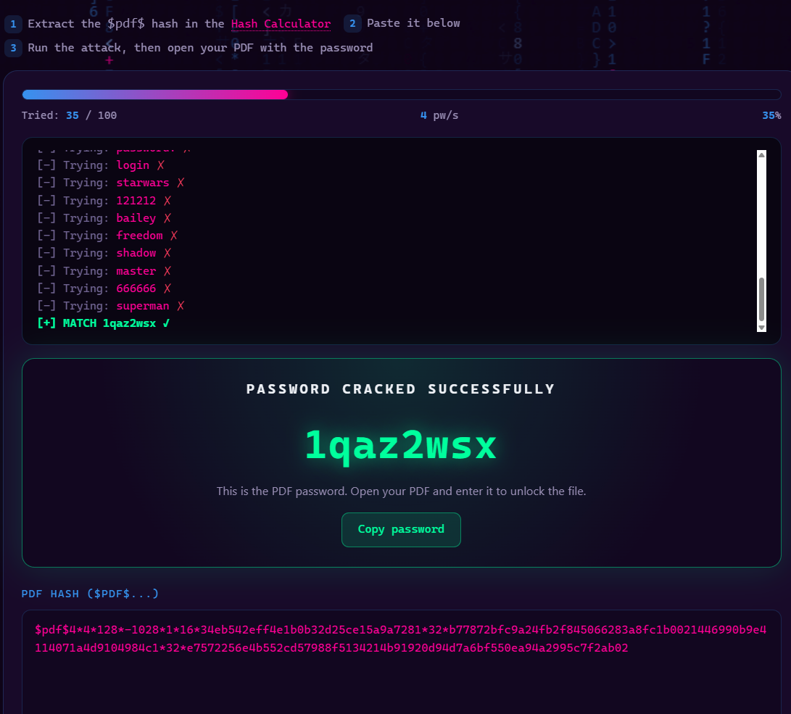

### 🔑 PDF 3 — My-Locked-PDF3.pdf

**Hash extracted:**

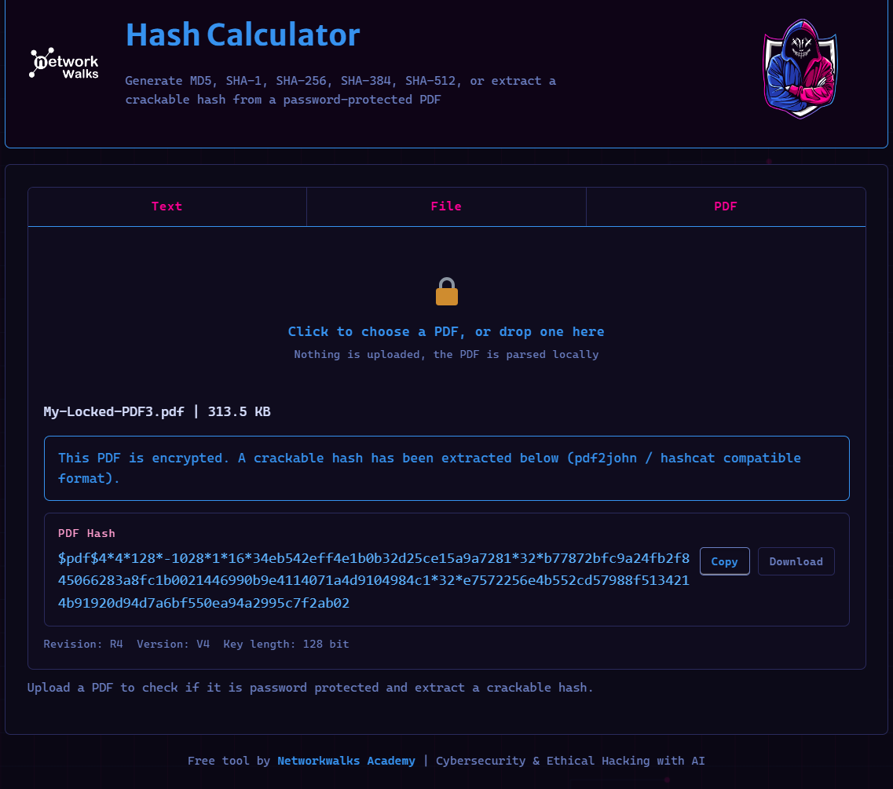

---

## 🔎 Verification Summary

| ✅ Test | 🧾 Method | 🎯 Result |
|---|---|---|
| 🔑 Extract PDF hash (x3) | `pdf2john` / Networkwalks Hash Calculator | `$pdf$...` hash generated for each PDF ✔️ |
| 🖥️ Crack hash locally | John the Ripper (Johnny GUI) | `good-luck`, `password1`, `1qaz2wsx` recovered ✔️ |
| 🌐 Crack hash in-browser | Networkwalks Password Cracker | `password1`, `1qaz2wsx` matched ✔️ |
| 📄 Open protected PDFs | Adobe Acrobat Reader | All PDFs unlocked, flags visible ✔️ |

---

## 💡 What I Learned

Through this project, I gained practical experience in:

- **Hash extraction:** Converting a password-protected PDF into a crackable hash
  format (`$pdf$...`) compatible with John the Ripper and hashcat.
- **Local password cracking:** Using John the Ripper's Johnny GUI to load a hash
  file and run a dictionary attack without typing long commands.
- **Browser-based cracking:** Performing the same workflow with Networkwalks' Hash
  Calculator and Password Cracker, with no tools to install.
- **Comparing tools:** Confirming that both the local (JTR) and web-based
  (Networkwalks) workflows recover the identical password from the identical hash
  format across multiple PDFs.
- **Password strength awareness:** Observing how quickly common, short passwords
  like `password1`, `1qaz2wsx` and `good-luck` are cracked — reinforcing the need for
  long, unique passwords.
- **Technical documentation:** Recording commands, steps, results, and screenshots
  in a clear, professional README.

---

## 🔐 Security & Ethical Use

I performed this lab strictly for educational purposes using PDF files provided
specifically for the exercise.

I will only use password-cracking techniques on files and systems I own or have
explicit permission to test. All experiments were conducted responsibly and within
the scope of the lab assignment.

---

## 🔗 Tools & Resources

| Resource | Description |
|---|---|
| [John the Ripper](https://www.openwall.com/john/) | Password cracking tool (CLI) |
| [Johnny](https://openwall.info/wiki/john/johnny) | GUI front-end for John the Ripper |
| [Networkwalks Hash Calculator](https://networkwalks.com/hash-calculator/) | Browser-based hash extraction tool |
| [Networkwalks Password Cracker](https://networkwalks.com/password-cracker/) | Browser-based dictionary-attack tool |

---

## 👤 Author

**Mayuresh Sangale**

Third-Year Computer Engineering Student
Cybersecurity Intern — Networkwalks

🔗 LinkedIn: [Mayuresh Sangale](https://www.linkedin.com/in/mayuresh-sangle-586879268)

---

## 📌 Project Information

| Field | Details |
|---|---|
| Program Name | Cybersecurity at Networkwalks |
| Week | Week 03 |
| Project | Password Cracking with JTR & Networkwalks Tools |
| Repository | NETWORKWALKS-B084E-WK3-PM-PASSWORD-CRACKING |

*Built with 💻, documented with 📝, and secured with 🛡️*
*Learning cybersecurity one lab at a time.*
